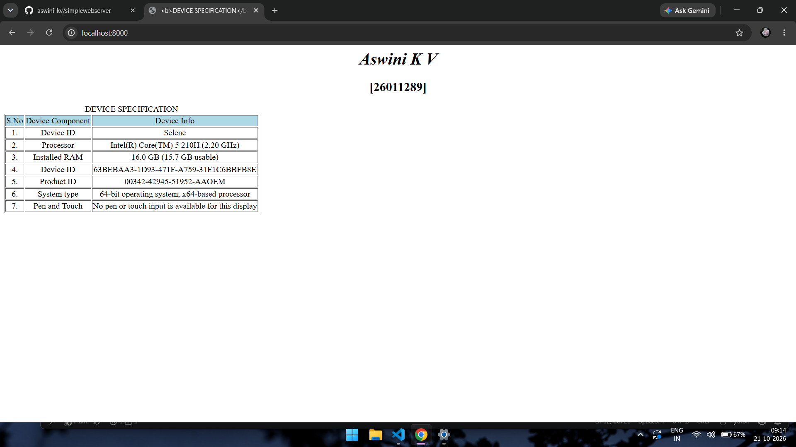
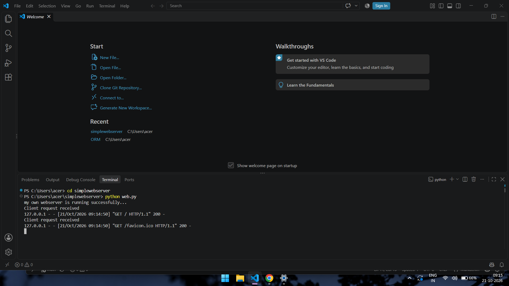

# EX01 Developing a Simple Webserver
## Date: 28/09/2026

## AIM:
To develop a simple webserver to serve html pages and display the Windows Specifications of your Laptop.

## DESIGN STEPS:
### Step 1: 
HTML content creation.

### Step 2:
Design of webserver workflow.

### Step 3:
Implementation using Python code.

### Step 4:
Import the necessary modules.

### Step 5:
Define a custom request handler.

### Step 6:
Start an HTTP server on a specific port.

### Step 7:
Run the Python script to serve web pages.

### Step 8:
Serve the HTML pages.

### Step 9:
Start the server script and check for errors.

### Step 10:
Open a browser and navigate to http://127.0.0.1:8000 (or the assigned port).

## PROGRAM:
```
from http.server import HTTPServer, BaseHTTPRequestHandler
content = """
<html>
    <head> 
        <title> <b>DEVICE SPECIFICATION</b> </title>
    </head>
     <h1 align="center"><i> Aswini K V</i></h1>
     <h2 align="center">[26011289]</h2>
     <table border="1" cellspacing="2" cellpading="10">
        <caption align="centre">DEVICE SPECIFICATION</caption>
        <tr bgcolor="lightblue" align="center">
            <td> S.No </td>
            <td> Device Component</td>
            <td> Device Info </td>

        <tr align="center"> 
            <td> 1. </td>
            <td> Device ID </td>
            <td> Selene </td>
        </tr>
         <tr align="center"> 
            <td> 2. </td>
            <td> Processor </td>
            <td> Intel(R) Core(TM) 5 210H (2.20 GHz)  </td>
        </tr>
         <tr align="center"> 
            <td> 3. </td>
            <td> Installed RAM </td>
            <td> 16.0 GB (15.7 GB usable)</td>
        </tr>
        
        <tr align="center">
            <td> 4. </td>
            <td> Device ID </td>
            <td> 63BEBAA3-1D93-471F-A759-31F1C6BBFB8E </td>
            </tr>
        <tr align="center">
            <td> 5.</td>
            <td> Product ID </td>
            <td> 00342-42945-51952-AAOEM </td>
        </tr>

        <tr align="center">
            <td> 6.</td>
            <td> System type </td>
            <td> 64-bit operating system, x64-based processor </td>
        </tr>

        <tr align="center">
            <td> 7. </td>
            <td> Pen and Touch </td>
            <td> No pen or touch input is available for this display</td>
        </tr>

     </table>
    </body>   
</html>
"""
class myhandler(BaseHTTPRequestHandler):
    def do_GET(self):
        print("Client request received")
        self.send_response(200)
        self.send_header('content-type', 'text/html; charset=utf-8')
        self.end_headers()
        self.wfile.write(content.encode())
server_address = ('',8000)
httpd = HTTPServer(server_address,myhandler)
print("my own webserver is running successfully...")
httpd.serve_forever()

```

## OUTPUT:
Web page: 

Web Server: 


## RESULT:
The program for implementing simple webserver is executed successfully.
